# 全站业务流程图（代码交叉验证版）

> 日期：2026-10-30
> 目的：把现有代码中的业务状态、角色交接、触发条件和关键副作用画成相互独立的流程图。
> 口径：优先以当前 API、领域逻辑和 Prisma schema 为准；较早的 `docs/codebase/*` 与旧帮助文案可能落后于当前代码。本文是代码现状梳理，不代表所有流程都已符合业务期望。

## 0. 阅读方式与边界

- 下图按业务流程拆分。订单、司机/时段分配、日销售、拣货、配送、回单核销、司机钱款核销、退货、开票、采购、主数据各自独立；图之间通过订单号、波次、行程、客户、发票等对象交接。
- `Order.status` 是订单生命周期状态；`PickingWave.status`、`Trip.status`、`Order.returnStatus`、`Order.goodsReturnStatus`、`Invoice.status` 是各自独立的状态字段，不能混成一个“订单状态”。
- `returnStatus` 表示回收的送货单/回单是否核对；`goodsReturnStatus` 和 `OrderReturn`/Trip 内 `ReturnItem` 表示货物退换货处理。两者不是一回事。
- Mermaid 图中的“停止/等待”表示当前代码校验或待办所在位置；“需业务确认”表示静态代码无法替代业务口径判断。

## 1. 订单流程（独立）

销售确认后订单会进入销售单模块查询。订单列表不是单独实体：报价单和销售单都是 `Order`，以状态区分；`PENDING` 属于报价，确认后同一条订单变为 `CONFIRMED`，并可在销售单模块查询。

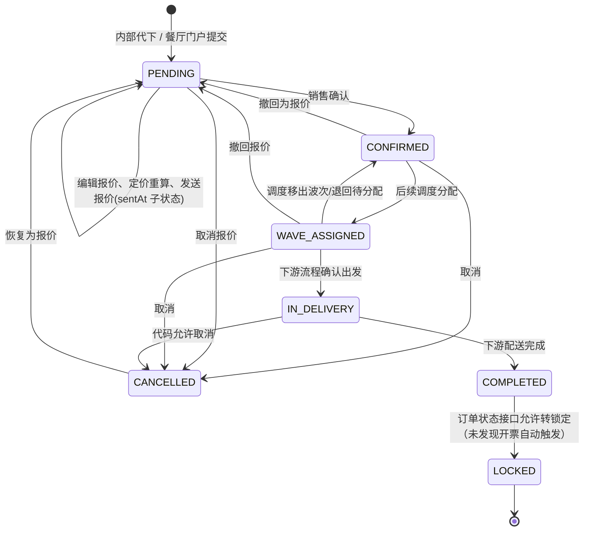

### 订单状态与动作

| 状态/动作 | 当前含义 | 流转与限制 |
|---|---|---|
| `PENDING` | 报价单，尚未确认 | 可编辑；`sentAt` 是发送时间子状态，不是新枚举状态；可取消，取消后可恢复成报价 |
| `CONFIRMED` | 销售确认的订单 | **出现在销售单模块**；可编辑或撤回；可供调度分配 |
| `WAVE_ASSIGNED` | 已进入配送波次 | 可由调度移出退回 `CONFIRMED`；已分配订单的送货日期随波次日期 |
| `IN_DELIVERY` | 已确认离仓/配送中 | 司机/司机时段不允许直接改；属于活动波次时不能从订单详情绕过波次直接改为在途 |
| `COMPLETED` | 配送完成 | 默认实送量在完成时写为订购量；允许后续核销修正 |
| `LOCKED` | 业务锁定 | 订单 API 允许 `COMPLETED → LOCKED`；发票过账路由只回写已开票数量，未看到其直接推进订单状态。订单列表默认筛选含 `CONFIRMED/WAVE_ASSIGNED/IN_DELIVERY/COMPLETED`，不含 `LOCKED` |
| `CANCELLED` | 作废/取消 | 报价取消可恢复到 `PENDING`；已出库订单取消是否补库存，须按实际 `syncOrderStock` 调用上下文复核 |

销售确认本身**不等于实际出库**。当前库存实扣发生在波次确认出发；采购侧则在“确认收货”时增加库存。销售单和调度归属是两个模块：订单详情上的司机显示可能由所属波次派生。

**主要实现位置：** `app/api/orders/[id]/route.ts`、`app/api/orders/route.ts`、`lib/order-status.ts`、`lib/orders-query.ts`、`app/[locale]/classic/operator/orders/page.tsx`、`app/[locale]/classic/operator/quotations/page.tsx`。

## 2. 选择司机、时段与托盘分配（独立）

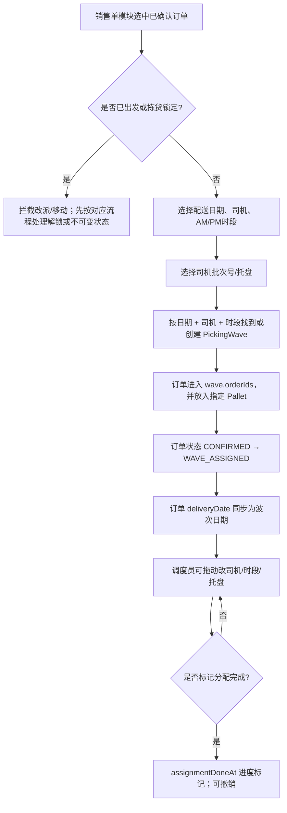

- 波次唯一粒度是**某日 + 司机 + 上午/下午**；批次号在当前模型里是波次下的托盘序号，不是独立车辆/行程。
- 一张订单在基本分配路径中整单进一个托盘；另有更细粒度托盘编辑能力，允许重新码放商品。
- 拖入/移出波次时，状态在 `WAVE_ASSIGNED` 和 `CONFIRMED` 间变化；订单 `deliveryDate` 跟波次日期保持一致。
- `DELETE /api/waves/[id]/pick-lock` 只清拣货锁并保留分配；`POST /api/waves/[id]/pick-unlock` 会清锁、清空订单/托盘分配，并把 `WAVE_ASSIGNED` 退回 `CONFIRMED`，两者后果不同。
- 只有 `CONFIRMED` / `WAVE_ASSIGNED` 可分配；未确认报价、已出发/已完成订单不能分配。
- 已拣货锁定或已出发的波次不能改派。司机槽位归档会清理尚未出发波次中的对应托盘订单，退回待分配。

**主要实现位置：** `app/api/waves/[id]/assign/route.ts`、`app/api/waves/[id]/unassign/route.ts`、`app/api/orders/[id]/batch/route.ts`、`lib/wave-assign.ts`、`app/api/driver-slots/[id]/route.ts`、`app/[locale]/classic/operator/dispatch-console/_components/BatchTab.tsx`。

## 3. 日销售中心如何控制当天订单与作业（独立）

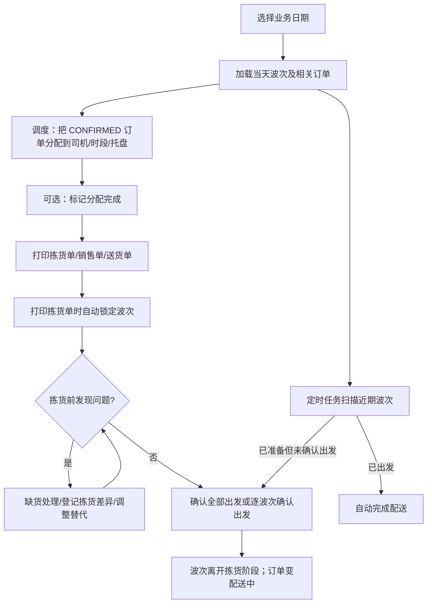

- 日销售中心主要以**送货日期/波次日期**组织作业；销售确认订单通过分配进入波次。
- 波次的 `assignmentDoneAt` 是可撤销的分配进度标记；打印拣货单的 `pickLockedAt` 是作业锁，两者不是同一状态。
- 打印可自动锁波次；锁定期间调度不能移动订单。解锁后仍保留司机安排。出发后不允许重新开拣货锁。
- 自动完成任务扫描最近约 30 天、截至今天的波次；对已出发、已标记分配完成或已拣货锁定的非空波次，可先补做出发再完成配送。不是仅扫描当天 22:00。
- 仅“分配了司机/进入波次”不会触发 22 点任务；还必须有 `assignmentDoneAt`、`pickLockedAt` 或 `dispatchedAt` 其中之一。若前一天安排的是次日波次，次日 22 点才进入日期范围；但若已标记分配完成或打印锁定，任务会自动出发并立即完成。
- 若排司机前漏把 `deliveryDate` 改成实际送货日，销售单分配入口会按错误日期建波次；进入 `WAVE_ASSIGNED` 后订单日期绑定波次，不能直接改日期，需先从波次移出/退回待分配，再改日期并重新分配。若错误日期当日波次已标记完成/锁定，22 点可能提前出发、扣库存并完成订单。
- 缺货处理和差异登记并非订单核销。差异记录有自己的状态/解决方式，具体影响实送量需结合对应处理动作。

**主要实现位置：** `app/[locale]/classic/operator/daily-sales/`、`app/[locale]/classic/operator/dispatch-console/`、`app/api/waves/generate-daily/route.ts`、`app/api/waves/[id]/pick-lock/route.ts`、`app/api/waves/[id]/dispatch/route.ts`、`app/api/cron/auto-confirm-departure/route.ts`、`app/api/cron/auto-complete-delivery/route.ts`、`docs/20261029-delivery-status-flow-clarification.md`。

## 4. 拣货/分货（独立）

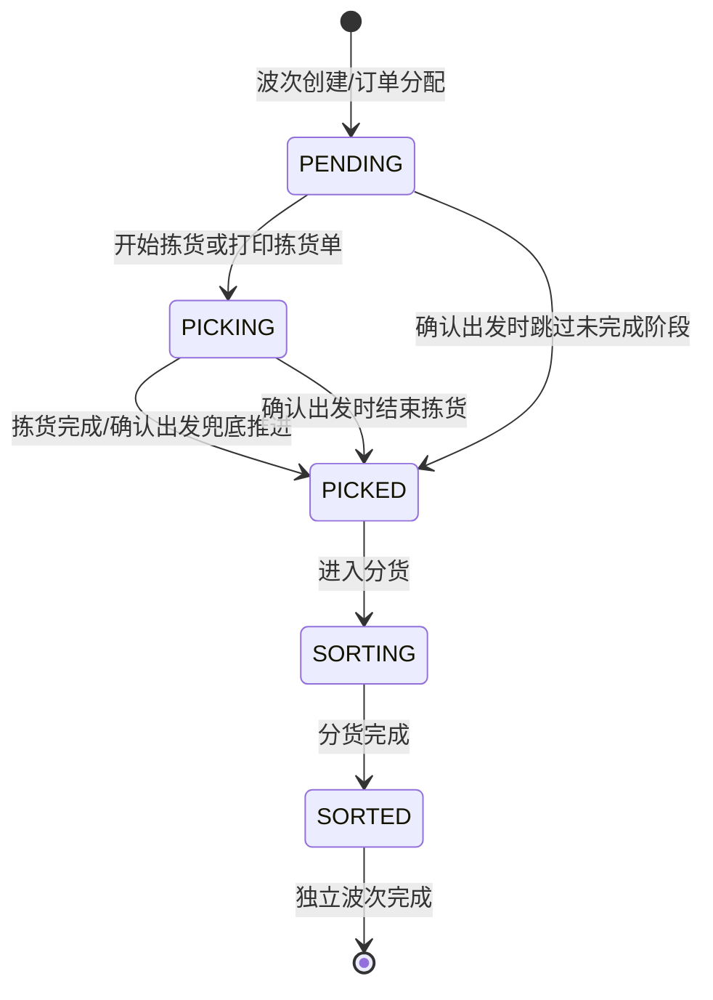

- `PickingWave.status` 只表示拣货/分货阶段；`pickLockedAt`、`dispatchedAt`、`completedAt` 是独立时间戳标志。
- 下图是界面常规作业路径，不是严格后端状态机：波次更新 API 在出发前未实现完整的状态转换白名单；打印配送单、汇总单或销售单也可能触发拣货锁。
- 拣货清单按单位属性分大货/散货；`expandByCustomer` 决定散货是否按客户展开。单位的这些打印属性和销售单位换算属性是不同维度。
- 记录短少、替代、重量差异可创建 `OrderDiscrepancy`；需要走差异处理接口，不能把登记等同于已经确认给客户或开票。

**主要实现位置：** `app/api/waves/[id]/route.ts`、`app/api/waves/[id]/shortage/route.ts`、`app/api/order-discrepancies/[id]/route.ts`、`app/api/waves/[id]/pallets/route.ts`、`lib/wave-complete.ts`、`lib/pack-split.ts`。

## 5. 配送与司机行程（独立）

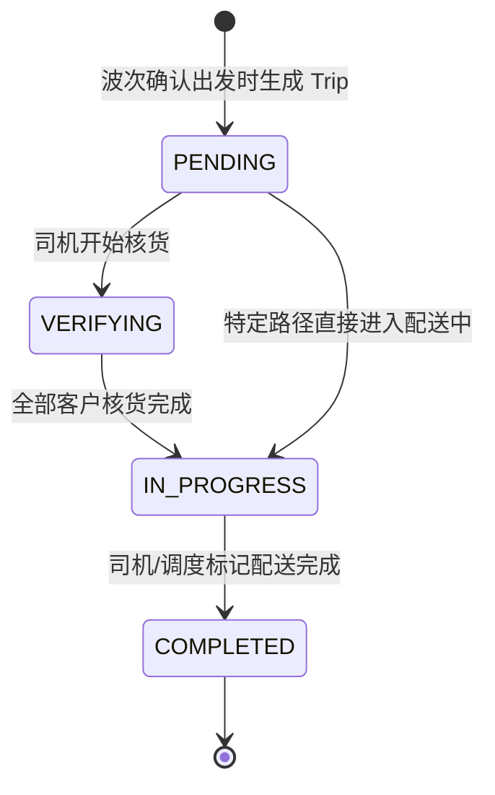

配送交接规则：

1. “确认出发”把波次标记 `dispatchedAt`，清除拣货锁；订单变为 `IN_DELIVERY`，写送货日期/送货单，按订单行扣库存，并由波次生成一条司机 `Trip`。
2. 司机核货可记录 `verifiedQty`。所有站点核货后 `Trip` 推进到 `IN_PROGRESS`；发现数量差异时走行程差异接口处理。
3. 配送完成后订单转 `COMPLETED`，默认 `deliveredQty = orderedQty`；库存扣减按目标量幂等补漏。完成配送本身不生成正式发票。
4. 司机签收资料/签名有独立校验；已完成的波次/行程作为配送记录收尾。定时任务也可能完成漏处理的配送。

波次生成行程之外，`POST /api/trips` 还保留手工建行程路径：可按订单、司机、时段创建，更新订单为 `IN_DELIVERY` 并扣库存；另有兼容旧数据的 JSON 餐厅列表路径。Trip 的常规状态路径是 `PENDING → VERIFYING → IN_PROGRESS → COMPLETED`，但通用更新 API 没有完整转换白名单，因此图示是正常业务路径，不代表所有跳转都被服务端禁止。

**库存时点：**销售货物实扣的主要动作在确认出发；完成动作只对未扣成功的订单补扣，以免出库漏记或重复扣减。

**主要实现位置：** `lib/wave-dispatch.ts`、`lib/delivery-complete.ts`、`lib/trip-from-wave.ts`、`app/api/trips/[id]/verify/route.ts`、`app/api/trips/[id]/discrepancy/route.ts`、`app/api/trips/[id]/route.ts`、`app/api/cron/auto-complete-delivery/route.ts`。

## 6. 回单（送货单）核销（独立于货物退货）

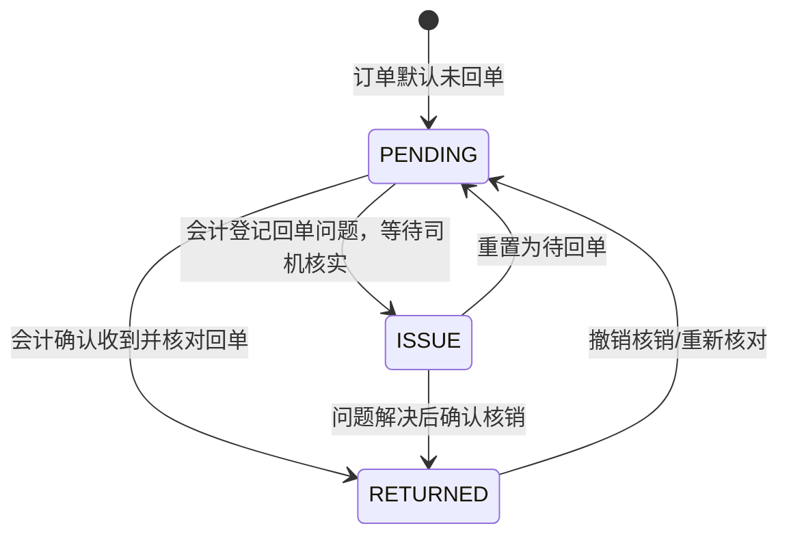

- 核销清单只取已离仓订单：`IN_DELIVERY`、`COMPLETED`、`LOCKED`；已确认和已分配订单尚未出车，不进清单。历史订单有启用日期下限。
- `PENDING`、`ISSUE` 在“待核销”列表；确认的 `RETURNED` 仍在主列表展示 24 小时，之后进入“已核销”页签。
- 核销时可修正实际送达数量；有数量差异时单张订单核销，可批量核销默认送达量。
- 核销确认 `RETURNED` 后自动尝试生成草稿发票，并同步提成快照。若生成失败，核销不会回滚；“补开漏开发票”只接受已核销订单。
- 这里的“核销订单”指**核回单**；司机带回钱款是另一套按“司机 × 送货日”确认的财务核销。

**主要实现位置：** `lib/accounting/returns.ts`、`app/api/accounting/returns/route.ts`、`app/api/orders/bulk/route.ts`（`mark_returned`）、`app/api/accounting/returns/[id]/lines/route.ts`、`app/api/accounting/returns/bulk-invoice/route.ts`、`docs/20261026-核销触发开票与对账单口径-需求原话.md`。

## 7. 司机带回的现金/转账核销（独立）

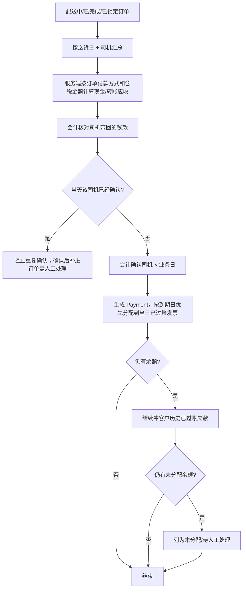

- 页面跨天保留未确认的“司机 × 送货日”组；刚确认的组保留 24 小时。确认快照防止订单重复计入。
- 金额由订单含税额及 `paymentMethod` 推导（`CASH` 算现金，其余算转账），不是直接信司机输入的数字。
- 当前司机现金汇总按订单行金额计算，没有计入 `OrderAdjustment`；而行程汇总及开票会纳入调整行。含配送费、折扣或差价调整的订单，司机现金应收与发票/行程金额可能不一致，需财务口径确认或修正实现。
- 只能冲已过账发票；如果关联当日草稿发票未过账，会被跳过/提示等待会计先过账。无当日发票仍会尝试冲抵同客户历史欠款，超出部分可能留在未分配余额。
- 会计确认会产生 `Payment` 和收款凭证；操作不可撤销，错误需走人工冲正。

**主要实现位置：** `lib/accounting/driver-cash.ts`、`app/api/accounting/driver-cash/route.ts`、`app/api/accounting/driver-cash/confirm/route.ts`、`lib/trip-settlement-payment.ts`。

## 8. 货物退换货、仓库验货、销售审核（独立）

目前有两种入口，最终共用相同的处置规则：司机从行程上报，或日销售中心人工登记。该流程与第 6 节回单核销无关。

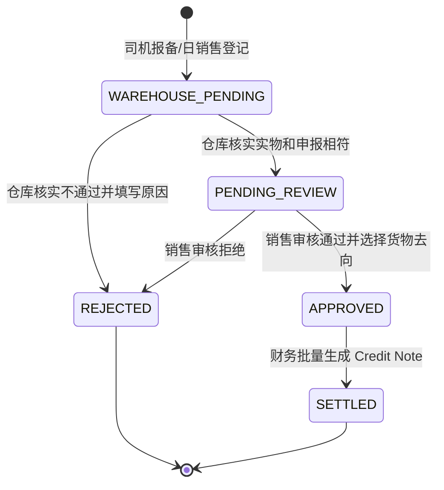

- 货物尚未送达的订单不能走人工退货登记；人工入口目前接受 `IN_DELIVERY` 或 `COMPLETED`。
- 仓库核实前状态是 `WAREHOUSE_PENDING`。仓库通过后才进入 `PENDING_REVIEW`，由销售/运营审核；仓库拒绝需填原因并终止该申请。
- 销售通过时必须指定 `SELLABLE`（可再售）或 `SCRAP`（报废）。系统回写实送数量并记库存：可再售回库存并按 FEFO 补批次；报废记录退货和报废两笔库存流水，净在库不增加。
- 拒绝审核只更新状态，不做库存/订单数量调整。
- 批量生成 Credit Note 只取 `APPROVED` 记录，按客户合并成贷记单，并把退货记录推进到 `SETTLED`。
- 代码生成的退货贷记单行将税率和税额设为 0；若原销售行含税，这条自动路径不会按原税额反向冲销，需会计确认这是预期规则还是实现缺口。
- 司机端 Trip 退货使用 `Trip.restaurants[].returns`；人工登记用 `OrderReturn` 表。两条路径界面/数据载体不同，但仓库/销售处置共用 `lib/returns-engine.ts`。

**主要实现位置：** `app/api/trips/[id]/returns/route.ts`、`app/api/trips/[id]/returns/warehouse-verify/route.ts`、`app/api/order-returns/route.ts`、`app/api/order-returns/[id]/warehouse-verify/route.ts`、`app/api/order-returns/[id]/review/route.ts`、`lib/returns-engine.ts`、`app/api/credit-notes/generate-from-returns/route.ts`。

## 9. Credit Note（贷记单）及客户余额去向

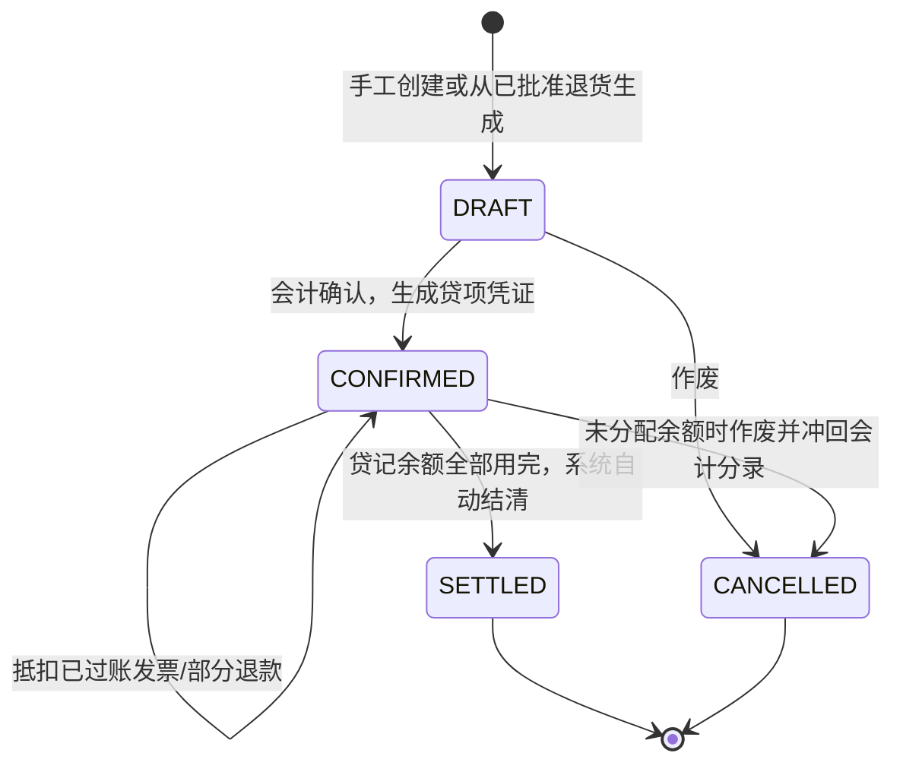

- Credit Note 可抵扣同客户已过账发票，也可退款给客户；每一笔去向存入 `CreditNoteAllocation`。
- 已用贷记单不能直接作废；要先撤销各笔抵扣/退款，撤销以追加冲正记录方式完成。
- 贷记单确认会记总账；抵扣发票降低应收余额但不重复记凭证，实际退款另记退款凭证。
- 从退货生成的 CN 按客户合并；生成时退货从 `APPROVED` 转 `SETTLED`。普通手工建 CN 不要求关联退货。

**主要实现位置：** `app/api/credit-notes/route.ts`、`app/api/credit-notes/[id]/route.ts`、`app/api/credit-notes/[id]/allocations/route.ts`、`app/api/credit-notes/[id]/allocations/[allocationId]/reverse/route.ts`、`lib/finance/credit-note-allocation.ts`。

## 10. 发票、客户收款与开票后处理

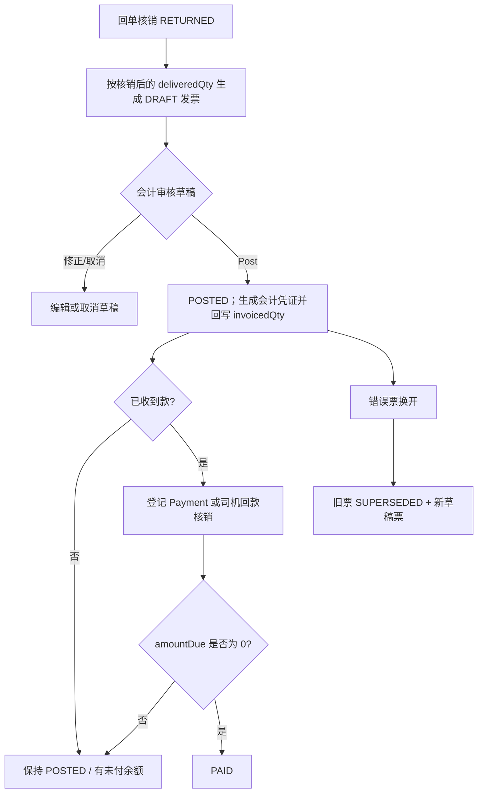

- 自动草稿按 `deliveredQty` 计算商品行；调整行（折扣、配送费、差价等）也进入发票。
- `DRAFT → POSTED` 是过账专用动作；普通更新 API 不接受直接写 `POSTED`/`PAID`。过账在事务中生成销售凭证，并回写行级 `invoicedQty`。
- 只有 `POSTED`/`PAID` 发票能登记普通收款；不可超出应收余额。付款后重算 `amountPaid`、`amountDue`，付清转 `PAID` 并生成收款凭证。
- 若发票有错误且需要替换，换开接口将旧票设为 `SUPERSEDED` 并创建新草稿票；不重复换开已被取代的票。
- **草稿由回单核销触发，正式过账仍需会计动作**。发票 Post 生成会计凭证并回写 `invoicedQty`，没有同步订单 `LOCKED` 的代码。

**主要实现位置：** `lib/invoice-from-order.ts`、`app/api/orders/bulk/route.ts`、`app/api/invoices/[id]/post/route.ts`、`app/api/invoices/[id]/reissue/route.ts`、`app/api/payments/route.ts`、`lib/accounting.ts`。

## 11. 餐厅客户交易流水/对账单

当前代码中的客户应收明细由**订单销售、发票、收款 Payment、贷记单**共同构成；本轮未找到独立的“餐厅交易流水单”模型/API。财务对账单是期间快照，不是每笔交易单据。

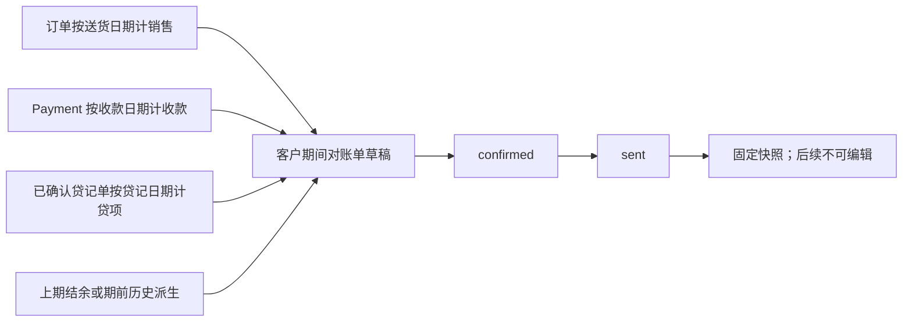

- `closingBalance = openingBalance + totalSales - totalPayments - totalCredits`。
- 对账单销售额由订单商品行计算，不含 `OrderAdjustment`；与含调整行的发票金额可能不一致。
- 销售按 `deliveryDate` 纳入期间；Payment 按 `paidAt`；Credit Note 按 `creditDate`。首期没有前序对账单时，期初按历史销售和收款派生。
- 对账单状态 `draft → confirmed → sent`；`confirmed` 可退回草稿，`sent` 后不可变。
- 需业务确认：用户所说的“给餐厅客户开一个交易流水”是否就是开具/发送期间对账单，还是要独立的逐笔客户流水单。当前代码只能确认订单、发票、收款、贷项是来源记录；没有发现独立交易流水实体。

**主要实现位置：** `app/api/statements/route.ts`、`app/api/statements/[id]/route.ts`、`lib/finance/statement.ts`、`app/api/cron/generate-statements/route.ts`。

## 12. 采购建议、采购单、收货与供应商账单

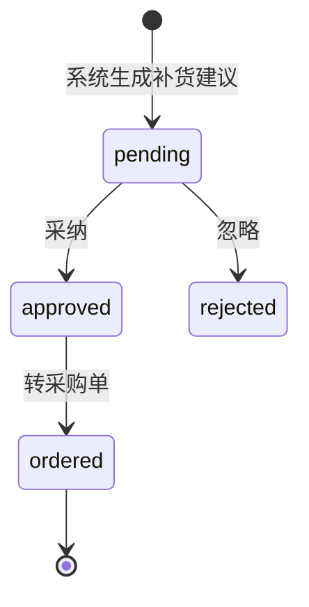

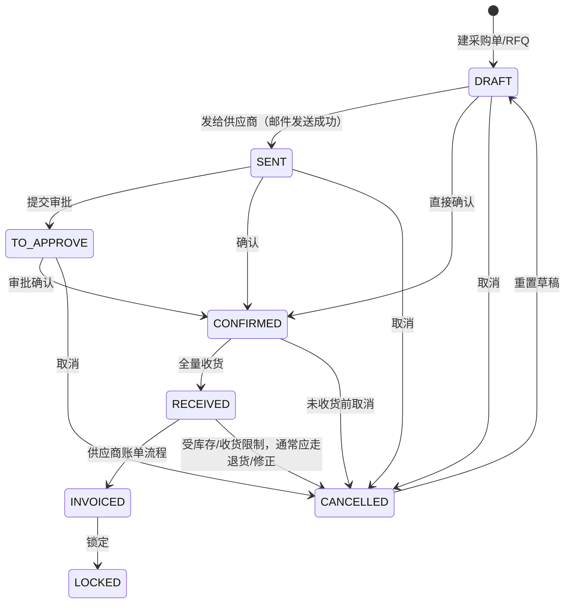

收货有两个动作，不要混淆：

1. `POST /api/goods-receipts` 记录“仓库看到什么”、到货时间、质检、照片，并通知采购；**不改库存**。
2. 采购单详情执行“确认收货”，按剩余量/实际数量更新 `receivedQty`、建库存批次和流水、增加 `qtyOnHand`；分批未收齐时采购单仍为 `CONFIRMED`，可再次确认收货。

其他关键点：

- `SENT → TO_APPROVE` 是显式动作；代码未发现基于金额自动触发审批阈值。是否应该设置大额阈值属于待确认业务规则。
- 非欧元汇率未补齐时，禁止进入 `CONFIRMED`。确认时运费分摊进落地成本并更新商品成本基准价。
- 采购单确认时自动创建/关联供应商账单草稿；采购单 `INVOICED` 是采购状态，供应商账单自身另有 `DRAFT/POSTED/PAID/CANCELLED` 状态。
- 采购单只要已有实收数量，取消会被拦截；不能用取消代替退货。

**主要实现位置：** `app/api/purchase-suggestions/`、`app/api/purchase-orders/[id]/route.ts`、`lib/purchase/receive-purchase-order.ts`、`app/api/goods-receipts/route.ts`、`lib/vendor-bill-from-po.ts`、`app/api/vendor-bills/[id]/route.ts`。

## 13. 商品、单位与价格表维护（主数据独立流程）

### 商品维护

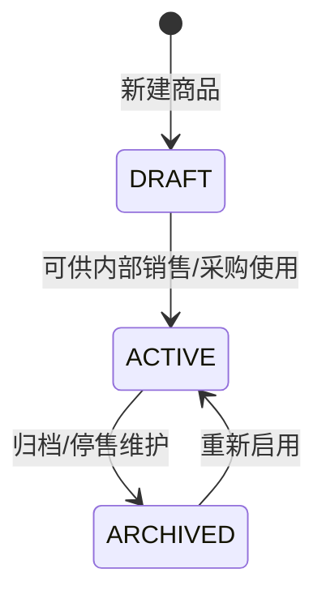

商品是否能出现在特定业务入口还受独立开关控制：`canBeSold`、`canBePurchased`、`showInPortal`。门户隐藏不等于内部停售；商品 `type`（PRODUCT/CONSU/SERVICE）影响库存和采购行为。

### 单位/可售单位

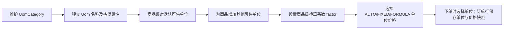

- 全局 `Uom` 负责单位名称、类别、拣货大货/散货、是否按客户展开；全局 `Uom.factor` 不承担商品箱规换算。
- `ProductSaleUom.factor` 表示“1 个此可售单位 = factor 个商品基础单位”，库存按商品默认/基础单位存。比如卖 1 箱会按商品自己的箱规换算库存。
- `ProductSaleUom` 可设一个默认单位；可售单位另有启用状态、规格、售价模式、提成价模式和装货顺序。
- 采购单位另由 `Product.purchaseUomId` 指定；采购行和订单行保存各自单位快照。

### 价格表与客户定价

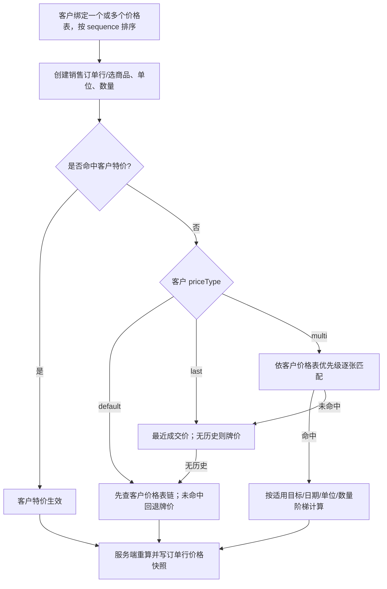

- 客户特价优先。`default` 先按顺序解析客户关联的价格表链，未命中才回退牌价；`last` 取最近已确认销售价、没有时回退牌价；`multi` 依次尝试价格表链，再回退最近成交价和牌价。
- 价格规则可按目标、日期、单位及最小数量阶梯匹配，支持折扣/公式；历史最近成交价按精确单位筛选时，不会把其他单位价格当作同一单位价格。
- 服务端在保存/下单时重新计算价格；权限允许时可采纳手动改价并留来源说明。订单行保存单位、单价、税率和价格来源快照，之后改价格表不会改写历史订单。
- 价格规则自身可 `selectable=false` 暂停销售使用；价格表也有 `active` 和 `selectable` 标志。

**主要实现位置：** `app/api/products/`、`app/api/uoms/`、`app/api/pricelists/`、`app/api/customers/[id]/route.ts`、`lib/product-sale-uom-upsert.ts`、`lib/sale-uom-server.ts`、`lib/server-pricing.ts`、`lib/pricing-engine.ts`、`prisma/schema.prisma`。

## 14. 全局交叉验证结论与待处理差异

### 交叉验证结论

本轮对照了 Prisma 状态定义、对应 API 路由、领域逻辑和主要页面查询/操作路径。以下是代码能直接支持的结论：

1. **销售确认后可在销售单模块查询。** 报价与销售单共用 `Order`；确认把状态改为 `CONFIRMED`，销售单列表默认状态筛选包含该状态。
2. **订单、波次、行程、回单、货物退货、发票是分开的状态对象。** 回单 `RETURNED` 触发草稿发票；商品退货经仓库验货和销售审核后，才能生成贷记单。
3. **库存有明确的出入库时点。** 销售实扣主要发生在波次出发；采购实收入库发生在采购单确认收货，单纯登记 GoodsReceipt 不改库存。
4. **司机回款确认要求可分配的已过账发票。** 同日已过账发票优先，其后尝试客户历史已过账发票；草稿发票不会被冲账。
5. **发票过账不自动锁订单。** 订单 `LOCKED` 是允许的独立状态转换，本轮未找到开票过账到订单锁定的联动。
6. **没有独立客户交易流水模型/API。** 当前账务来源是订单、发票、Payment、Credit Note；Statement 是周期快照。

### 已确认的实现缺口或跨模块差异

| 项目 | 代码交叉验证结果 | 影响 |
|---|---|---|
| 订单调整金额 | 开票/行程汇总纳入 `OrderAdjustment`；司机现金汇总和客户对账单销售额仅按订单商品行算 | 有配送费、折扣、差价时，各模块金额可能不一致 |
| 退货贷记税额 | 自动从退货生成的贷记单行写入 `taxRate=0`、`taxAmount=0` | 含税退货不会在自动路径反向冲销原销售税额 |
| 波次/行程状态 | 订单 API 有转换白名单；波次更新和 Trip 通用更新未形成同等级别的完整状态白名单 | 图中是常规流程，不代表后端禁止所有非法跳转 |
| 拣货解锁 | 清除 pick lock 与清除锁及整个分配是两个不同接口 | 操作会分别保留司机安排，或整波退回待分配 |
| 自动完成配送 | 定时任务覆盖最近约 30 天到今天且有准备/出发标记的非空波次 | 自动兜底范围大于单日，不宜按“当天 22:00”理解 |

### 需业务口径确认

1. `OrderAdjustment` 应否计入司机应收及客户对账单销售额？这是已定位的跨模块计算差异。
2. 自动退货贷记单是否应继承原销售税额/税率？现代码统一写 0。
3. 是否要求发票过账后自动把订单转成 `LOCKED`？当前没有此联动。
4. “给餐厅开交易流水”是否指期间对账单，还是需要新增逐笔流水视图/单据？当前没有独立交易流水实体。
5. `ISSUE` 回单问题由谁跟进、解决后由谁复核？代码提供状态操作，但业务责任角色不完全由后端限定。

### 其他已核实口径

- 旧版文档中“销售确认扣库存”“配送完成直接开票”等说法与当前代码不符；本文以当前实现为准。
- 退货司机上报和日销售人工登记使用不同数据入口，但后续仓库/销售处置规则共用。
- 手工建 Trip 是波次出发之外的兼容/操作路径，也会直接把订单置为 `IN_DELIVERY` 并扣库存。
- 波次出发自动生成的 Trip 初始为 `PENDING`；按站点核货通常推进到 `VERIFYING`，全部核完后进入 `IN_PROGRESS`，但服务端通用更新并未严格禁止其他状态跳转。
- 订单状态接口允许 `COMPLETED → LOCKED`，但销售单列表默认筛选不含 `LOCKED`；若要查锁定订单需切换筛选条件。

## 15. 主要代码和文档索引

- 状态定义：`prisma/schema.prisma`
- 订单状态和库存：`app/api/orders/[id]/route.ts`、`lib/order-stock.ts`、`lib/wave-dispatch.ts`、`lib/delivery-complete.ts`
- 司机/时段分配和波次：`lib/wave-assign.ts`、`app/api/waves/[id]/assign/route.ts`、`app/[locale]/classic/operator/dispatch-console/`
- 回单/钱款：`lib/accounting/returns.ts`、`lib/accounting/driver-cash.ts`、`lib/trip-settlement-payment.ts`
- 退货与贷记单：`lib/returns-engine.ts`、`app/api/order-returns/`、`app/api/trips/[id]/returns/`、`app/api/credit-notes/`
- 发票、收款、对账：`lib/invoice-from-order.ts`、`app/api/invoices/`、`app/api/payments/`、`lib/finance/statement.ts`
- 采购、收货、供应商账单：`app/api/purchase-orders/`、`lib/purchase/receive-purchase-order.ts`、`app/api/goods-receipts/`、`app/api/vendor-bills/`
- 较新业务决策：`docs/20261026-核销触发开票与对账单口径-需求原话.md`、`docs/20261027-veggie-退货报废整合-需求原话.md`、`docs/20261028-veggie-退换货5步流程-需求原话.md`、`docs/20261029-delivery-status-flow-clarification.md`
